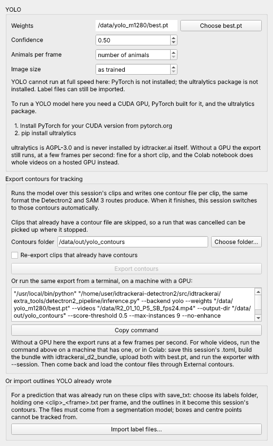

# Tracking from a YOLO segmentation model

If you have already trained a YOLO segmentation model with ultralytics
(YOLO11-seg, YOLO26-seg, ...), its `best.pt` can make the contours idtracker.ai
tracks, in place of a Detectron2 Mask R-CNN or SAM 3. It is the fast route: a
medium model keeps up with the video on one GPU, where SAM 3 manages one or two
frames per second.

Everything after the contours is unchanged. idtracker.ai reads them through
`external_contours`, detects crossings, builds fragments and assigns identities
as it always does, so the result is one trajectory per animal.

## What YOLO output can be tracked from

idtracker.ai tells animals apart from the pixels inside each animal's outline,
on every frame it tracks. That decides what is usable:

| What you have | Usable? | How |
|---|---|---|
| `best.pt` of a segmentation (`-seg`) model | yes | `backend = 'yolo'`: the model is run over the video |
| Label files of a segmentation prediction (`save_txt=True`), one per frame | yes | `idtrackerai_yolo_import`, or **Import label files** in the app |
| `best.pt` of a detection model, or box label files | no | Boxes have no outline. Train or use the `-seg` variant. |
| A table of centre points (x, y per animal per frame) | no | Points have no outline, so there are no pixels to identify from. |
| Detections on only some frames (every 4th, 6 fps of a 24 fps video) | no | Fragments are built by linking each frame to the next. |

For the last two, run the segmentation model over the video again. That is
what the `yolo` backend does, and it only runs the frames in
`tracking_intervals`.

## Install

On the machine that runs the model (a workstation with a CUDA GPU, or Colab):

```bash
pip install ultralytics
```

idtracker.ai never installs it for you and does not depend on it. ultralytics
is AGPL-3.0, and by its authors' terms so are weights trained with it; see
`NOTICE`.

## The session .toml

Start from [yolo-session-template.toml](yolo-session-template.toml):

```toml
name = 'R2_01_10_P5'
video_paths = ['/content/drive/MyDrive/sessions/R2_01_10_P5_SB_fps24.mp4']
number_of_animals = 9
track_wo_identities = false
roi_list = [
    '+ Polygon [[577, 85], [1370, 92], [1317, 843], [605, 843]]',
    '- Polygon [[900, 400], [1000, 400], [1000, 500], [900, 500]]',   # feeder
]
output_dir = '/content/out'

[segmentation_model]
backend = 'yolo'
weights = '/content/drive/MyDrive/yolo/best.pt'
score_threshold = 0.5
contours_dir = '/content/drive/MyDrive/contours/R2_01_10_P5'
```

| Key | Default | Meaning |
|---|---|---|
| `backend` | | `'yolo'` |
| `weights` | required | Path of the segmentation model's `best.pt`. |
| `score_threshold` | `0.7` | Confidence below which an outline is dropped. Set the value the model was validated at. |
| `imgsz` | the model's own | Size frames are resized to for the network. Leave unset to use the training size. |
| `max_instances` | `number_of_animals` | Most outlines kept per frame, best first. `0` keeps all. |
| `classes` | all | Class indices to keep, when the model has more than the animal. |
| `contours_dir` | required unless `external_contours` is set | Where the contour files go, one `<clip>.h5` per video. |
| `on_overlap`, `merge_overlap`, `min_component`, `dilate`, `dedup_iou`, `min_area` | as for the other backends | Mask clean-up, shared by every backend. |

`prompt`, `config`, `num_classes` and `min_size` belong to the other backends
and are refused here.

**Feeders and drinkers.** Put each one in `roi_list` as a `'- Polygon [...]'`
line after the `'+'` line of the pen. An outline is kept or dropped as a whole,
by its centre, so a detection sitting on a feeder never becomes an animal. YOLO
itself runs on the whole frame; the areas are subtracted when the contours are
read, so changing them does not need a new export.

**Enhancement.** A YOLO model was trained on the frames as recorded, so that is
what it is given. Only an `enhancement` table in the session, or an
enhancement flag on the command line, changes that. In the Segmentation App the
Frame enhancement control is therefore left out of the YOLO and SAM 3 modes
(and of External contours), unless the session already has enhancement switched
on; it stays with Thresholding and Detectron2.

## Run it

Export the contours where the GPU is, then track anywhere:

```bash
idtrackerai_d2_export --session session.toml     # runs YOLO, writes contours_dir/<clip>.h5
idtrackerai --load session.toml --track          # tracks from them
```

The export can be stopped and restarted: finished clips are skipped, and a
file made with other weights, confidence, image size or frame range is redone.
Before tracking, idtracker.ai checks the contour files against the table and
refuses ones that do not match.

Without a `.toml`:

```bash
idtrackerai_d2_export --backend yolo --weights best.pt \
    --videos 'clips/*.mp4' --output-dir contours/ \
    --score-threshold 0.5 --max-instances 9
```

### Exit codes, when scripting this

The two commands report success differently
([colab-idtrackerai-rules.md](colab-idtrackerai-rules.md)):

- `idtrackerai_d2_export` exits `0` on success, as usual.
- `idtrackerai` exits **`1` on success** and `0` on a failure it caught. Never
  judge a tracking run by its exit code. It succeeded when
  `session_<name>/trajectories/trajectories.npy` exists and `Success` is in
  `session_<name>/idtrackerai.log`.

### In Colab, from one notebook

The quickest way to a GPU. In the Segmentation App, the YOLO panel's **Save
Colab notebook...** button writes the open session as a notebook; from a
terminal, one notebook can carry many saved sessions:

```bash
idtrackerai_colab_notebook --session "sessions/toml/*.toml" --output run_colab.ipynb
```

Everything the sessions set is already in it: the model and its settings, the
region of interest, the number of animals, the tracking settings. Then:

1. Put the videos and `best.pt` in one folder on Google Drive. Subfolders are
   fine: each file is found by its name, and the notebook lists what it needs.
2. Open the notebook in Colab and set that folder in the first cell. It is the
   only thing to edit.
3. Choose a GPU runtime and Run all.

**Which settings each video gets.** The notebook reads the folder and decides
per video:

1. A companion `.toml` in the folder comes first: a file named after the video
   (`pen5.mp4`, `pen5.toml`), or any session `.toml` that lists the video in
   `video_paths`. It can sit in another subfolder, and it can have been written
   on Windows: only file names are used, `output_dir` and `contours_dir` are
   replaced.
2. Otherwise, a video the notebook was written for is run with the session
   saved in the notebook.
3. Any other video waits. The notebook's settings cell (model, weights, number
   of animals, region of interest, as Colab form fields) is for those, and is
   used only after you tick `USE_FOR_VIDEOS_WITHOUT_A_TOML`, so one pen's
   region of interest is never applied to another pen's video by accident. If
   no video has settings at all, the notebook stops there and says what to
   fill in.

`USE_THIS_MODEL_FOR_EVERY_VIDEO` in the same cell replaces the model named in
every `.toml` with the one in the settings cell. That is how session files
written for SAM 3 are run with a YOLO model without editing them.

`idtrackerai_colab_notebook --output run_colab.ipynb` with no `--session`
writes a notebook that works purely from the folder.

It installs this fork and `ultralytics`, exports the contours, tracks each
session on the Colab disk, copies each finished one to `tracked/` in the Drive
folder, and keeps `tracking_timetable.csv` there (GPU, start, end and hours per
session, read from each `idtrackerai.log`). After a disconnect, Run all again:
what is finished is skipped. Paths of your own computer are never written into
the notebook.

The same button and command work for [SAM 3](sam3-pipeline.md) and
[Detectron2](detectron2-pipeline.md) sessions; the notebook installs only the
package its model needs. To install the fork from a branch instead of the
default one, pass `--install-from "git+https://github.com/mbel-tech/idtrackerai-CYSM.git@<branch>"`.

### In Colab, by hand

Build the bundle on your own machine with `idtrackerai_d2_bundle`, upload it
with `best.pt` and the session `.toml` files, and in a GPU runtime:

```python
!pip install -q ultralytics h5py toml
!python tools/detectron2_export_contours.py --session "/content/drive/MyDrive/sessions/toml/*.toml" --local-cache /content/cache
```

`--local-cache` copies each video to the Colab disk first, which is much faster
than decoding from the Drive mount.

## In the Segmentation App

**Segmentation → YOLO** shows the panel:



- **Choose best.pt**, then set the confidence. *Animals per frame* follows the
  session's number of animals and *Image size* the model's training size unless
  you set them.
- **Export contours** runs the model over the session's clips (only the
  tracking intervals) and switches the session onto the files when it finishes.
  With no GPU it asks first, since a CPU manages only a few frames per second.
- **Copy command** gives the same export for a machine with a GPU.
- **Import label files** takes the `labels` folder of a prediction that was
  already run with `save_txt=True` and makes the contour files from it.

Saving the parameters writes the `[segmentation_model]` table above, and
opening that `.toml` again brings the panel back as it was.

## Importing label files from a terminal

```bash
yolo segment predict model=best.pt source=pen5.mp4 save_txt=True save_conf=True
idtrackerai_yolo_import --video pen5.mp4 --labels runs/segment/predict/labels \
    --output contours/pen5.h5 --weights-name best.pt --score-threshold 0.5 --max-instances 9
```

ultralytics names the files `<clip>_<frame>.txt`, counting frames from 1. A
frame with no file had no detections and is imported empty. Label files beyond
the end of the video are an error, because they mean the labels were made from
another video or at another frame rate. The outlines are imported as written:
the exporter's mask clean-up and overlap handling are not applied.

Then track with `external_contours = 'contours/pen5.h5'`.

## Choosing between the backends

| | Detectron2 | SAM 3 | YOLO |
|---|---|---|---|
| Needs your own annotations | yes | no | yes (the model is already trained) |
| Speed on one GPU | medium | 1 to 2 fps | fastest |
| Knows your setup | yes | no | yes |
| Licence of the runtime | Apache-2.0 | SAM License | AGPL-3.0 |
